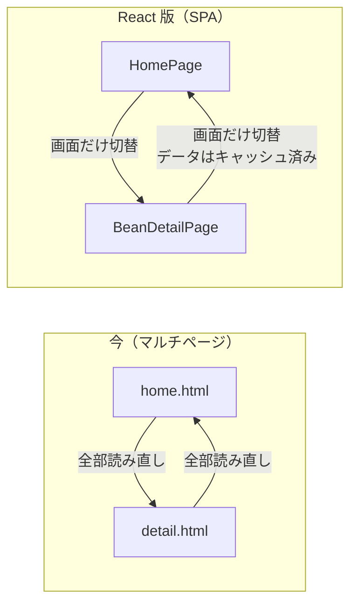
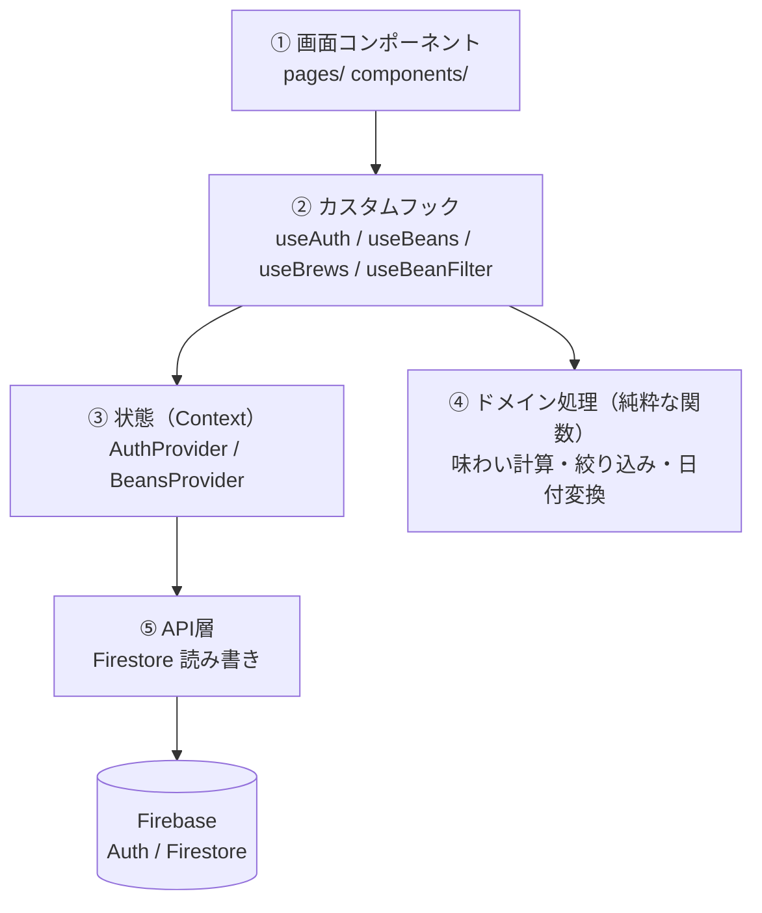
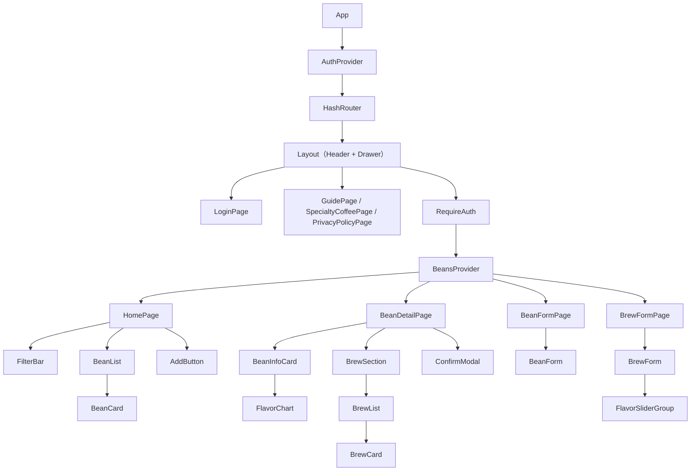

# React リファクタリング設計書

このドキュメントは、現在の reCoder（Vanilla JS + Firebase のマルチページ構成）を **React** で作り直すための設計です。

方針は次の2つです。

1. **全体構造と処理を崩さない**: Firestore のデータ構造・画面の流れ・バリデーション・見た目（CSS）はそのまま残す
2. **処理を速くする**: ページ移動のたびに起きている「再読み込み・再ログイン確認・再取得」をなくし、描画と通信の無駄を減らす

> 新しく出てくる用語は、その場で簡単に説明しています。末尾の「用語集」にもまとめています。

---

## 目次

1. [現状の構成と、遅くなっている原因](#1-現状の構成と遅くなっている原因)
2. [技術選定](#2-技術選定)
3. [全体アーキテクチャ](#3-全体アーキテクチャ)
4. [ルーティング（URL設計）](#4-ルーティングurl設計)
5. [コンポーネント設計](#5-コンポーネント設計)
6. [状態管理とデータ取得](#6-状態管理とデータ取得)
7. [処理の高速化ポイント](#7-処理の高速化ポイント)
8. [崩してはいけない仕様（互換性チェックリスト）](#8-崩してはいけない仕様互換性チェックリスト)
9. [ディレクトリ構成案](#9-ディレクトリ構成案)
10. [既存コードとの対応表](#10-既存コードとの対応表)
11. [移行ステップ](#11-移行ステップ)
12. [リスクと注意点](#12-リスクと注意点)
13. [用語集](#13-用語集)

---

## 1. 現状の構成と、遅くなっている原因

### 1-1. 現状の構成

| ページ | HTML | JS | 主な役割 |
|---|---|---|---|
| ログイン | `index.html` | `auth.js` | ログイン / 新規登録 |
| 一覧 | `home.html` | `home.js` | 豆の一覧・検索・絞り込み・並び替え・お気に入り |
| 詳細 | `detail.html` | `detail.js` `modal.js` | 豆の情報・味わいグラフ・抽出記録一覧・削除 |
| 豆フォーム | `bean-form.html` | `bean-form.js` | 豆の新規登録 / 編集 |
| 抽出フォーム | `brew-form.html` | `brew-form.js` | 抽出記録の新規追加 / 編集 |
| 静的ページ | `description.html` ほか3つ | （インラインscript） | ご利用ガイド・スペシャルティコーヒー・プライバシーポリシー |

共通処理は `common.js`（ログイン確認・日付変換・味わい計算）、`api.js`（Firestore 読み書き）、`menu.js`（jQuery のドロワー）にまとまっています。

### 1-2. 遅くなっている原因

コードを読んで見つかった、体感速度に効いている箇所です。

| # | 原因 | 該当箇所 |
|---|---|---|
| A | **ページ移動のたびに全部やり直している**。一覧→詳細→一覧と移るたびに、Firebase SDK・Lucide・jQuery の読み込み、ログイン状態の復元（`onAuthStateChanged` の待ち）、Firestore の再取得が毎回走る | 全ページの `<script>` と `initPage()` |
| B | **詳細ページの通信が直列**。`loadLog` → `migrateLegacyBrewIfNeeded` → `loadBrews` → `refreshBeanSummary` を1つずつ待っている | `detail.js` の `initPage` |
| C | **抽出記録の保存で3往復**。`saveBrew` → `loadBrews`（全件読み直し）→ `updateLog`（集計値の更新）を順に待ってから画面移動し、移動先の詳細ページでまた全部読み直す | `brew-form.js` の保存処理 |
| D | **検索1文字ごとに一覧を全部作り直している**。`innerHTML` でカードを全て作り直し、さらに `lucide.createIcons()` がページ全体を走査してアイコンを描き直す | `home.js` の `renderList()` |
| E | **compat 版 Firebase SDK を使っている**。使わない機能も含めて丸ごと読み込むため、ファイルが大きい | 各HTMLの `firebase-*-compat.js` |
| F | **Lucide を `@latest` で全アイコン読み込み**。数十個しか使っていないのに全アイコン分をダウンロードしている（バージョンも固定されていない） | 各HTMLの `unpkg.com/lucide@latest` |
| G | **jQuery をドロワーの開閉だけに使っている** | `menu.js` |
| H | **グラフを毎回破棄→再生成** | `detail.js` の `renderChart()` |
| I | **一覧のお気に入りは通信完了を待ってから見た目が変わる**（詳細ページは先に見た目を変えているので、挙動もそろっていない） | `home.js` のクリック処理 |

---

## 2. 技術選定

| 役割 | 採用するもの | 理由 |
|---|---|---|
| UI | **React 19** | コンポーネント単位で画面を組み立てられる |
| ビルドツール | **Vite** | 起動・反映が速く、設定がほぼ不要 |
| ルーティング | **React Router v7** | 1つのHTMLの中でURLごとに画面を切り替える |
| Firebase | **Firebase JS SDK v11 の modular 版** | 使う関数だけを取り込めるので小さくなる |
| アイコン | **lucide-react** | 使うアイコンだけが取り込まれる。`createIcons()` が不要になる |
| グラフ | **Chart.js（必要な部品だけ登録）** | 今のグラフの見た目をそのまま再現できる |
| 状態管理 | **React 標準の Context + useReducer** | データ量が小さいので外部ライブラリは不要 |
| 言語 | **JavaScript（JSX）** | 今のコードの書き方に近い。TypeScript は後から段階的に導入できる |
| テスト | **Vitest** | 計算・絞り込みなどの関数が、移行前と同じ結果になるかを確かめる |
| CSS | **今の CSS ファイルをそのまま読み込む** | クラス名を変えなければ見た目は変わらない |

**用語の説明**

- **Vite（ヴィート）**: React などのコードを、ブラウザで動く形に変換・まとめてくれる道具（ビルドツール）。開発中は保存した瞬間に画面へ反映される。
- **React Router**: URL（`/beans/abc123` など）と表示する画面の対応を決めるライブラリ。ページを丸ごと読み直さずに画面だけを切り替える。
- **modular 版 SDK**: Firebase の新しい書き方。`import { getDoc } from 'firebase/firestore'` のように必要な関数だけを取り込む。今の compat 版は `firebase.firestore()` のように全部入りのオブジェクトを使う書き方。
- **JSX**: JavaScript の中に HTML のような見た目でUIを書ける記法。`<h2>{beanName}</h2>` のように `{}` で値を埋め込める。

### 外す（不要になる）もの

- **jQuery**: ドロワーの開閉は React の状態（`useState`）で書ける
- **`escapeHtml()`**: React は `{}` に入れた文字列を自動で安全に表示してくれるので不要になる（ただし `dangerouslySetInnerHTML` は使わないこと）
- **`lucide.createIcons()`**: `lucide-react` のコンポーネント（`<Star />` など）に置き換わる
- **`?v=5` のようなキャッシュ対策**: Vite がビルド時にファイル名へハッシュ（中身から作る識別子）を付けるので不要になる
- **`tools/check_pages.py`**: HTMLの id と JS の対応チェックは、React では id で要素を探さなくなるため不要。代わりに ESLint（コードの書き方チェック）と Vitest を使う

---

## 3. 全体アーキテクチャ

### 3-1. マルチページ → SPA

今は「HTMLファイル5つ × 毎回フル読み込み」ですが、React 版では **SPA** にします。

- **SPA（シングルページアプリケーション）**: HTMLは最初に1回だけ読み込み、以降はURLが変わっても JavaScript が画面の中身だけを差し替える方式。SDK の読み込みやログイン確認が **最初の1回だけ** で済む。



### 3-2. 層（レイヤー）の分け方

処理を役割ごとに分けて、画面（コンポーネント）が Firestore を直接触らないようにします。今の `api.js` / `common.js` の分け方をそのまま発展させた形です。



- **カスタムフック**: `use` で始まる自作の関数。「データを読み込んで状態として持つ」などの処理を、画面から切り離して再利用できる。
- **Context（コンテキスト）**: 親で持っているデータを、間のコンポーネントを経由せずに子孫のどこからでも読めるようにする React の仕組み。ログイン中のユーザーや豆の一覧のように「どの画面でも使うデータ」に向いている。
- **純粋な関数**: 同じ入力なら必ず同じ結果を返し、外部（画面・通信）に影響しない関数。`buildFlavorSummary()` や `sortBeans()` が該当し、テストしやすい。

### 3-3. コンポーネントの全体ツリー



---

## 4. ルーティング（URL設計）

| 今のURL | React 版のURL | 画面コンポーネント | ログイン必須 |
|---|---|---|---|
| `index.html` | `/` | `LoginPage` | いいえ（ログイン済みなら `/home` へ） |
| `home.html` | `/home` | `HomePage` | はい |
| `detail.html?id=X` | `/beans/X` | `BeanDetailPage` | はい |
| `bean-form.html` | `/beans/new` | `BeanFormPage` | はい |
| `bean-form.html?id=X` | `/beans/X/edit` | `BeanFormPage` | はい |
| `brew-form.html?beanId=X` | `/beans/X/brews/new` | `BrewFormPage` | はい |
| `brew-form.html?beanId=X&brewId=Y` | `/beans/X/brews/Y/edit` | `BrewFormPage` | はい |
| `description.html` | `/guide` | `GuidePage` | いいえ |
| `specialty-coffee.html` | `/specialty-coffee` | `SpecialtyCoffeePage` | いいえ |
| `privacy-policy.html` | `/privacy-policy` | `PrivacyPolicyPage` | いいえ |

- `?id=` のような **クエリパラメータ** から、`/beans/:id` のような **パスパラメータ** に変えます。React Router の `useParams()` で取り出せます（今の `getQueryParam()` の置き換え）。
  - **useParams()**: URL の `:id` の部分に入っている値を取り出すフック。
- 今の `goToDetail()` などのページ移動関数は、React Router の `useNavigate()` で書き直します。
  - **useNavigate()**: コードから画面移動するための関数を返すフック。`navigate('/home', { replace: true })` で、今の `location.replace()` と同じく履歴を残さない移動ができる。
- **古いURLの互換**: ブックマーク対策として、`detail.html?id=X` などの旧URLを新URLへ転送します。GitHub Pages では React で受け止められないため、転送専用の小さなHTMLを置く方式にします（4-2 で説明）。

### 4-1. GitHub Pages では `HashRouter` を使う

デプロイ先は **GitHub Pages** なので、ルーターは **`HashRouter`** に決定します。

- **HashRouter**: URL の `#` より後ろを使って画面を切り替える方式。`#` より後ろはサーバーに送られないので、サーバーには常に `index.html` へのアクセスとして届く。

#### なぜ必要か（今の仕組みとの違い）

今のreCoderは「1画面＝1個の実在するHTMLファイル」という作りです。

```text
一覧画面   → home.html
詳細画面   → detail.html?id=abc123
```

ブラウザが `detail.html?id=abc123` にアクセスすると、サーバー（GitHub Pages）は「`detail.html` というファイルをください」と言われたと理解し、実在するそのファイルを返します。

React版（SPA）にすると、実在するHTMLファイルは `index.html` 1つだけになります。画面の切り替えは、ブラウザの中でJavaScript（React）が行います。ここで次の違いが生まれます。

1. **アプリの中でボタンを押して画面を移動する場合**: JavaScriptが画面の中身を差し替えるだけなので、サーバーには何も聞きに行かず問題なく動く
2. **そのURLを直接ブラウザに打ち込む・リロードする・ブックマークから開く場合**: ブラウザは「`/beans/abc123` というファイルをください」とサーバーに聞きに行く。しかし GitHub Pages には `beans/abc123` というファイルは存在しないため **404エラー** になる

Firebase Hosting や Vercel には「どんなURLが来ても `index.html` を返す」というサーバー側の設定（リライト）がありますが、**GitHub Pages にはその設定がありません。** そのためリロードやブックマーク、共有したリンクがすべて機能しなくなってしまいます。

#### `HashRouter` がこれを解決する仕組み

`HashRouter` は、画面の種類を表す情報を URL の `#`（ハッシュ記号）より後ろに入れる方式です。

```text
通常のURL（BrowserRouter）:  https://recoder-application.github.io/reCoder-app/beans/abc123
HashRouterのURL:            https://recoder-application.github.io/reCoder-app/#/beans/abc123
                                                                          ↑ここから後ろ
```

ポイントは、**ブラウザは `#` より後ろの部分をサーバーに一切送らない** という昔からの仕様です（元々は「ページ内の特定の見出しへジャンプする」ために使われてきた仕組みです）。

`#/beans/abc123` というURLを直接開いても、サーバーに実際に聞きに行くのは次の部分だけです。

```text
https://recoder-application.github.io/reCoder-app/
```

これは `index.html` を返すだけの普通のアクセスなので、GitHub Pages は何も困らず `index.html` を返せます。HTMLが届いた後、ブラウザの中で React が「`#` の後ろが `/beans/abc123` になっているから詳細画面を表示しよう」と判断し、正しい画面を出します。

| | 直接アクセス・リロード | GitHub Pagesでの可否 |
|---|---|---|
| `BrowserRouter`（`#`なし） | サーバーに `beans/abc123` というファイルを要求 → 存在せず404 | ❌ そのままでは動かない |
| `HashRouter`（`#`あり） | サーバーには `/`（＝index.html）しか要求されない | ✅ 問題なく動く |

デメリットは「URLに `#` が入って少し見た目が長くなる」ことだけで、機能的な制約はほぼありません。将来 Firebase Hosting などサーバー側の設定ができる環境へ引っ越す場合は、`BrowserRouter` に戻すことも可能です（React Router 側の数行の変更で済みます）。

実際のURLは次のようになります（リポジトリ `reCoder-application/reCoder-app` から推定）。

```text
https://recoder-application.github.io/reCoder-app/#/home
https://recoder-application.github.io/reCoder-app/#/beans/abc123
https://recoder-application.github.io/reCoder-app/#/beans/abc123/brews/new
```

上の表の「React 版のURL」は、すべてこの `#` の後ろの部分を指します。

> **採用しなかった案**: `BrowserRouter` のまま `404.html` に「index.html へ転送するスクリプト」を置く方法もあります。URL から `#` を消せますが、一瞬 404 ページを経由するうえに仕組みが分かりにくいので採用しません。

### 4-2. 旧URLの転送

ブックマークされている `https://…/reCoder-app/detail.html?id=X` を開くと、GitHub Pages はファイルを探しに行きます。`index.html` 以外には React が関われないので、**旧ファイル名と同じ名前の転送用HTML** を `public/` に置きます。

- `public/` に置いたファイルは、ビルド後もそのままの名前で公開される
- 中身は「URLの `?id=` などを読み取り、新しい `#/beans/X` のURLへ `location.replace()` する」だけの数行

| 置くファイル | 転送先 |
|---|---|
| `home.html` | `./#/home` |
| `detail.html?id=X` | `./#/beans/X` |
| `bean-form.html` / `bean-form.html?id=X` | `./#/beans/new` / `./#/beans/X/edit` |
| `brew-form.html?beanId=X&brewId=Y` | `./#/beans/X/brews/new` / `./#/beans/X/brews/Y/edit` |
| `description.html` `specialty-coffee.html` `privacy-policy.html` | `./#/guide` など |

ログイン画面の `index.html` は React の入口そのものなので、転送は不要です。

### 4-3. GitHub Pages 向けの設定

#### Vite の `base`

GitHub Pages のプロジェクトサイトは `https://<組織名>.github.io/<リポジトリ名>/` のように、**サブフォルダの下で公開** されます。Vite は何も指定しないとファイルを `/assets/...`（ドメイン直下）から読もうとするので、CSS や JS が 404 になります。

`vite.config.js` で `base: '/reCoder-app/'` を指定します。

- **base**: アプリを公開する場所（パス）を Vite に教える設定。ビルド時に、すべてのファイルの読み込み先にこのパスが付く。

> リポジトリ名を変えたり独自ドメインを使ったりした場合は、`base` も合わせて変える必要があります。

#### GitHub Actions で自動デプロイする

今は「`main` ブランチのファイルをそのまま公開」する設定になっているはずです。React 版はビルド（変換）してできた `dist/` フォルダを公開する必要があるため、**GitHub Actions** で「`main` に push されたらビルドして公開」を自動化します。

- **GitHub Actions**: GitHub 上で、push などをきっかけに決まった処理（ビルド・テスト・デプロイなど）を自動で実行してくれる仕組み。手順は `.github/workflows/` に YAML ファイル（**ワークフロー**）で書く。
- `dist/` は `.gitignore` に入っているのでリポジトリには含めない。GitHub Actions の中でビルドして、そのまま公開する。

ワークフローの流れ（`.github/workflows/deploy.yml`）:

```text
main に push
 → リポジトリを取得（actions/checkout）
 → Node.js を用意（actions/setup-node）
 → npm ci（依存パッケージのインストール）
 → npm test（Vitest。失敗したら公開しない）
 → npm run build（dist/ を作る）
 → dist/ を公開用にまとめる（actions/upload-pages-artifact）
 → GitHub Pages に公開（actions/deploy-pages）
```

- **npm ci**: `package-lock.json` に書かれたバージョンのとおりに、パッケージをきっちりインストールするコマンド。自動ビルドでは `npm install` よりこちらを使う。
- **artifact（アーティファクト）**: ワークフローの途中で作ったファイル一式のこと。ここでは `dist/` を公開用に固めたもの。

リポジトリの **Settings → Pages → Source** を「Deploy from a branch」から **「GitHub Actions」** に切り替えたタイミングで、React 版が公開されます。それまでは今の HTML 版が公開されたままなので、開発は別ブランチで安全に進められます。

#### Firebase の設定値の渡し方

`.env.local` は git に含めないため、GitHub Actions のビルドでは読めません。そこで次のように分けます。

- **手元の開発**: `.env.local` に書く
- **GitHub Actions**: リポジトリの **Settings → Secrets and variables → Actions → Variables** に同じ名前（`VITE_FIREBASE_API_KEY` など）で登録し、ビルドの手順で環境変数として渡す

Firebase の Web 用設定値は秘密の情報ではない（データはセキュリティルールで守られている）ので、Secrets ではなく Variables で十分です。

#### Firebase Authentication の承認済みドメイン

Firebase コンソールの **Authentication → 設定 → 承認済みドメイン** に `recoder-application.github.io` が入っていることを確認します（今の HTML 版がすでに GitHub Pages で動いているなら登録済みのはずです）。URL に `#` が付いてもドメインは同じなので、追加の設定は不要です。

#### キャッシュ

GitHub Pages はファイルを最大10分ほどブラウザにキャッシュさせます。Vite はビルドのたびに JS・CSS のファイル名を変える（中身から作ったハッシュを付ける）ので古いファイルが使われることはありませんが、`index.html` だけはデプロイ直後の数分間、古いものが表示される場合があります。

---

## 5. コンポーネント設計

### 5-1. 共通レイアウト

#### `Layout`
全ページ共通の枠。`<Header />` と、各ページの中身（`<Outlet />`）を並べる。

- **Outlet**: React Router で「ここに子ルートの画面を表示する」という目印のコンポーネント。

#### `Header`
今は5つのHTMLにまったく同じヘッダーがコピーされているので、1つにまとめる効果が大きい部分です。

| 子コンポーネント | 役割 | 置き換え元 |
|---|---|---|
| `MenuButton` | ドロワーを開くボタン | `#menu-box` |
| `Drawer` | 左から出るメニュー。`isOpen` を props で受け取り `open` クラスを付け外し | `#submenu-content` + `menu.js` |
| `DrawerOverlay` | 背景の暗幕。押すと閉じる | `#drawer-overlay` |
| `LogoutButton` | ログアウト。ログイン画面では表示しない | `#logout-btn` + `setupLogoutButton()` |

- **props（プロップス）**: 親コンポーネントから子コンポーネントへ渡す値。HTMLの属性のようなもの。例: `<Drawer isOpen={true} />`
- ドロワーの開閉状態は `Header` の中の `useState` で持ちます。CSS の `transition` はそのまま使えるので、アニメーションは今と同じです。
  - **useState**: コンポーネントに「変わる値（状態）」を持たせるフック。値が変わると画面が自動で描き直される。

#### `RequireAuth`
今の `initPage()` の置き換えです。

- ログイン確認中 → `<PageLoading />`（「読み込んでいます...」）を表示
- 未ログイン → `/` へ `replace` で移動
- ログイン済み → 子の画面を表示

`initPage()` はページごとに毎回動いていましたが、`RequireAuth` は **ログイン状態をアプリ全体で1回だけ監視** した結果を見るだけなので、画面移動時に待ち時間が発生しません。

### 5-2. 共通部品（複数の画面で使う）

| コンポーネント | 使う場所 | 置き換え元 | 備考 |
|---|---|---|---|
| `FlavorBars` | 一覧カード・抽出カード | `createFlavorBarsHtml()` | `React.memo` で包む |
| `FavoriteButton` | 一覧カード・詳細 | `updateFavoriteButton()` + ボタンHTML | `isFavorite` と `onToggle` を受け取る |
| `ConfirmModal` | 詳細（豆削除・抽出削除） | `modal.js` | `useConfirm()` フックとセット |
| `PageLoading` | 全ログイン必須ページ | `#page-loading` | 読み込み失敗時のメッセージもここ |
| `FormField` | 豆フォーム・抽出フォーム | `.form-group` のHTML | `label` と入力欄のセット |
| `ErrorMessage` | フォーム・ログイン | `showFormError()` / `showError()` | `message` が空なら何も表示しない |
| `EmptyMessage` | 一覧・抽出一覧 | `.empty-message` | |

- **React.memo**: 受け取る props が前回と同じなら、そのコンポーネントの描き直しを省略する仕組み。一覧のカードのように数が多い部品に使うと効果的。

#### `useConfirm()` フックの設計

今の `openModal(title, message, onConfirm)` と同じ使い勝手にします。

```text
const confirm = useConfirm();
// 使う側
const ok = await confirm({ title: '削除の確認', message: '…' });
if (ok) { await deleteLog(id); navigate('/home'); }
```

`await` で「実行」か「キャンセル」かを受け取れるので、コールバックを保存しておく `currentConfirmAction` が不要になります。

### 5-3. ログイン画面 `LoginPage`

| 子コンポーネント | 役割 |
|---|---|
| `AuthForm` | メール・パスワード入力、送信ボタン、Enter キー送信 |
| `AuthModeSwitch` | 「新規登録 ⇔ ログイン」の切り替えリンク |

- `isLoginMode` は `useState` で持ち、タイトルやボタンの文言はその値から決める（今の `textContent` 書き換えが不要になる）
- エラーコード→日本語メッセージの変換は `getAuthErrorMessage(code)` という純粋な関数に切り出す
- `<form onSubmit>` を使えば Enter キー送信はブラウザが自動でやってくれる
- ログイン済みなら `/home` へ `replace` で移動（今と同じ）

### 5-4. 一覧画面 `HomePage`

一番コンポーネント化の効果が大きい画面です。

| 子コンポーネント | 役割 | 置き換え元 |
|---|---|---|
| `FilterBar` | 検索・絞り込み・並び替えのまとまり | `.filter-bar` |
| └ `SearchInput` | 検索欄＋リセットボタン | `#search-input` `#search-clear` |
| └ `FilterSelect` | 焙煎度・精製方法のプルダウン（同じ部品を2回使う） | `#filter-roast` `#filter-process` + `updateSelectOptions()` |
| └ `SortSelect` | 並び替え | `#sort-select` |
| └ `FavoriteFilter` | お気に入りのみ | `#filter-favorite` |
| └ `ResultCount` | 「3件を表示中（全8件）」 | `updateResultCount()` |
| `BeanList` | カードの並び・空のときのメッセージ | `#card-area` + `renderList()` |
| └ `BeanCard` | カード1枚 | `createCardHtml()` |
| `AddButton` | 右下の「＋」ボタン | `#add-btn` |

**状態の持ち方**

- 豆の一覧データ: `BeansProvider`（Context）から `useBeans()` で受け取る
- 検索・絞り込み条件: `useBeanFilter()` フックで管理。中身は今の `filterState` と同じ形で、`sessionStorage` の同じキー（`recoder-home-filter`）に保存・復元する
- 表示する豆: `useMemo` で「データ」と「条件」から計算する（今の `getVisibleBeans()`）
- プルダウンの選択肢: `useMemo` で「データ」だけから計算する（今の `refreshFilterOptions()`）

- **useMemo**: 計算結果を覚えておき、元になる値が変わったときだけ計算し直すフック。検索語が変わっていないのに絞り込みをやり直す、といった無駄を防ぐ。

**イベント委譲について**: 今は `cardArea` にまとめてクリックイベントを付けていますが、React では各 `BeanCard` に `onClick` を書けば React が内部で同じような最適化をしてくれるので、`closest()` や `data-id` は不要になります。

### 5-5. 詳細画面 `BeanDetailPage`

| 子コンポーネント | 役割 | 置き換え元 |
|---|---|---|
| `BackLink` | 「一覧へ戻る」 | `.back-btn` |
| `BeanInfoCard` | 豆の基本情報のカード | `renderBeanInfo()` |
| └ `MetaRow` | 「項目名: 値」の1行。値が空なら何も描かない | `createMetaRowHtml()` |
| └ `FlavorChart` | 味わいの棒グラフ（Chart.js） | `renderChart()` |
| └ `BeanActions` | お気に入り・編集・削除ボタン | `.card-footer` |
| `BrewSection` | 抽出記録の見出し＋追加ボタン＋一覧 | `.brew-section` |
| └ `BrewList` / `BrewCard` | 抽出記録の一覧と1件分 | `renderBrewList()` / `createBrewCardHtml()` |

**`FlavorChart` の設計**

- `useRef` で `<canvas>` と Chart のインスタンスを保持する
  - **useRef**: 描き直しをまたいで値を保持できる箱。値を変えても画面は描き直されない。DOM要素を直接触りたいとき（Chart.js に canvas を渡すなど）にも使う。
- `useEffect` で、最初の1回だけ `new Chart()` し、味わいの値が変わったら `chart.data` を書き換えて `chart.update()` する（今は毎回 `destroy()` → 作り直し）
  - **useEffect**: 描画が終わった後に実行したい処理（外部ライブラリの操作・通信など）を書くフック。画面から消えるときの後片付け（`chart.destroy()`）も書ける。
- グラフの色・軸設定などのオプションは今の `renderChart()` の中身をそのまま定数として移す
- Chart.js は必要な部品（`BarController` `BarElement` `CategoryScale` `LinearScale`）だけを登録して小さくする
- `FlavorChart` は `React.lazy` で遅延読み込みし、Chart.js を詳細画面を開いたときだけダウンロードする

### 5-6. 豆フォーム `BeanFormPage`

| 子コンポーネント | 役割 |
|---|---|
| `BeanForm` | 入力欄9つ・エラー表示・保存/キャンセル |

- URL に `:id` があれば編集、なければ新規（今の `editingId` と同じ判定）
- 入力値は1つのオブジェクトの `useState` で持つ（**制御コンポーネント**）
  - **制御コンポーネント**: 入力欄の値を React の状態で管理する書き方。`value={form.country}` と `onChange` をセットで書く。`getElementById().value` で読み取る必要がなくなる。
- 入力欄の定義（id・ラベル・placeholder・必須か）を配列にまとめ、`map` で `FormField` を並べる（今の `BEAN_FIELD_IDS` の発展形）
- `isSaving` は `useState` で持ち、保存中はボタンを `disabled` にする（今と同じ二重送信防止）
- フォーム値 ⇔ Firestore の項目名の変換（`memo` ⇔ `note`、`productName || beanName`）は `beanToForm()` / `formToBean()` という純粋な関数に切り出す
- 編集時、一覧から来た場合は **キャッシュ済みの豆データを使って即座に表示** できる（通信待ちなし）

### 5-7. 抽出記録フォーム `BrewFormPage`

| 子コンポーネント | 役割 | 置き換え元 |
|---|---|---|
| `BrewForm` | 入力欄・エラー表示・保存/キャンセル | `brew-form.js` |
| └ `FlavorSliderGroup` | 5つのスライダー | `.slider-list` |
| 　└ `FlavorSlider` | スライダー1本と数値表示 | `bindFlavorSliders()` / `setFlavorSliders()` |

- `FlavorSliderGroup` は `FLAVOR_ITEMS` を `map` して作るので、**味わいの項目を増やすときに HTML を書き足す必要がなくなる**
- スライダーの値表示は状態から出すだけなので、`input` イベントで数字を書き換える処理が不要になる
- フォーム値 ⇔ Firestore の変換は `brewToForm()` / `formToBrew()` に切り出す（`toNumberOrNull` `dateInputToTimestamp` などはそのまま使う）

### 5-8. 静的ページ

`GuidePage` `SpecialtyCoffeePage` `PrivacyPolicyPage` は、今のHTMLの本文をほぼそのまま JSX に移すだけです。ヘッダーが `Layout` に統一されるので、`description.html` だけログアウトボタンが動かない（Firebase を読み込んでいない）という今の不具合も自然に直ります。

---

## 6. 状態管理とデータ取得

### 6-1. 状態の置き場所

| データ | 置き場所 | 理由 |
|---|---|---|
| ログイン中のユーザー | `AuthProvider`（Context） | 全画面で使う。監視はアプリ全体で1回だけ |
| 豆の一覧 | `BeansProvider`（Context） | 一覧・詳細・フォームで共有すれば、画面移動で読み直さなくて済む |
| 豆ごとの抽出記録 | `BeansProvider` 内に `beanId` ごとに保持 | 詳細→抽出フォーム→詳細の往復で読み直さなくて済む |
| 検索・絞り込み条件 | `useBeanFilter()`（＋ sessionStorage） | 一覧画面だけで使う。リロードしても残す（今と同じ） |
| フォームの入力値・保存中フラグ | 各フォームの `useState` | その画面だけで使う |
| ドロワーの開閉 | `Header` の `useState` | ヘッダーだけで使う |

### 6-2. 豆の一覧はリアルタイム購読にする（推奨）

今は画面を開くたびに `loadLogs()`（`get()`）で全件取得していますが、React 版では `BeansProvider` で **`onSnapshot` による購読** を1本だけ張ります。

- **onSnapshot**: Firestore のデータを「1回取得」ではなく「見張り続ける」関数。最初に全件が届き、以降は変更があった分だけ自動で届く。

これにより次のことが実現できます。

1. **画面移動でデータを読み直さない**: 一覧に戻っても、もう手元にあるデータで即座に表示できる
2. **別の端末での変更も反映される**: 今は「画面を開くたびに取得」なので常に最新でしたが、キャッシュにすると古くなる心配があります。購読なら変更が自動で届くので、今と同じ「常に最新」を保てます
3. **書き込みがすぐ画面に反映される**: Firestore には「自分が書き込んだ内容を、サーバーの返事を待たずに購読へ流す」仕組み（レイテンシ補償）があるので、お気に入り・編集・削除が即座に一覧へ反映される。手動でキャッシュを更新するコードが要らない

- **レイテンシ補償**: 書き込みの通信が終わる前に、手元のデータを先に更新して画面に反映する Firestore の機能。

> **代案**: 購読を使わず `get()` のまま、取得結果を Context にキャッシュして、書き込み時に手動でキャッシュを更新する方法もあります。仕組みは単純ですが、別端末の変更が反映されないので「画面を開いたときに裏で再取得する」処理が別途必要です。

### 6-3. 抽出記録の取得

- 詳細画面を開いたときに、その豆の `brews` サブコレクションを `onSnapshot` で購読する（画面を離れたら購読を解除）
- 取得結果は `BeansProvider` に `beanId` ごとに保存しておき、抽出フォームの保存時（後述）にも使う
- 並び順は今と同じく **JavaScript 側で `brewedAt` の新しい順** に並べる（Firestore の `orderBy` を使うと `brewedAt` のない古いデータが消えるため）

### 6-4. API層（`api/beans.js` `api/brews.js`）

今の `api.js` の関数名と引数はほぼそのまま残し、中身だけ modular 版の書き方にします。

| 今の関数 | React 版 | 変更点 |
|---|---|---|
| `loadLogs()` | `subscribeBeans(uid, onChange)` | `get()` → `onSnapshot()` |
| `loadLog(id)` | `loadBean(uid, id)` | キャッシュに無いとき（URL直接アクセス時）だけ使う |
| `saveLog(log)` | `createBean(uid, bean)` | 変更なし |
| `updateLog(id, log)` | `updateBean(uid, id, data)` | 変更なし |
| `deleteLog(id)` | `deleteBean(uid, id)` | 1件ずつの削除 → `writeBatch` でまとめて削除 |
| `toggleFavorite(id, v)` | `setFavorite(uid, id, v)` | 変更なし |
| `loadBrews(beanId)` | `subscribeBrews(uid, beanId, onChange)` | `get()` → `onSnapshot()` |
| `loadBrew(beanId, brewId)` | `loadBrew(uid, beanId, brewId)` | キャッシュに無いときだけ使う |
| `saveBrew` / `updateBrew` / `deleteBrew` | `saveBrewWithSummary(...)` など | 抽出記録と集計値を `writeBatch` で同時に書く |

- **uid を引数で受け取る**: 今は関数の中で `firebase.auth().currentUser` を見ていますが、`AuthProvider` が持っているユーザーを渡す形にすると、ログイン前に呼ばれて `null` になる、といった事故を防げます。
- **writeBatch**: 複数の書き込みを1回の通信でまとめて送る仕組み。全部成功するか全部失敗するかのどちらかになる（途中までしか書き込まれない状態にならない）。1回に500件まで。

---

## 7. 処理の高速化ポイント

効果の大きい順に並べています。「1章の原因」のどれに対応するかも書いています。

### 7-1. 【効果：大】SPA化でページ移動の読み込みをなくす（原因 A）

- SDK・アイコン・CSS の読み込み、ログイン状態の復元は **最初の1回だけ** になる
- 一覧→詳細→一覧の移動は、画面の差し替えだけで済む

### 7-2. 【効果：大】データの共有と購読で再取得をなくす（原因 A・B・C）

- 一覧で取得した豆データを詳細・フォームで使い回す。**一覧から詳細を開いたとき、豆の情報は通信を待たずに表示できる**
- 詳細から一覧に戻ったときも即表示（6-2 の購読）

### 7-3. 【効果：大】詳細画面の通信を並列化する（原因 B）

今は4つの処理を順番に待っています。React 版では次のようにします。

```text
今:      loadLog → migrate → loadBrews → refreshBeanSummary → 表示
React版: [キャッシュから豆を即表示]
         ├ 移行済み(migratedToBrews=true)なら → brews の購読をすぐ開始
         └ 未移行なら → migrate → brews の購読を開始
         brews が届いたら抽出一覧とグラフを表示
         refreshBeanSummary は表示の後で実行（画面は待たない）
```

- `migrateLegacyBrewIfNeeded()` は新しいデータでは何もしないので、ほとんどの場合は待ち時間ゼロになる
- `refreshBeanSummary()` は「集計値が変わっていたら書き込む」だけなので、表示をブロックする必要がない（今の「変化がなければ通信しない」判定はそのまま残す）

### 7-4. 【効果：大】抽出記録の保存を1往復にする（原因 C）

```text
今:      saveBrew（1往復）→ loadBrews（1往復）→ updateLog（1往復）→ 詳細ページで全部読み直し
React版: 手元の抽出一覧 + 今回の記録 で集計値を計算
         → writeBatch で「抽出記録」と「豆の集計値」を同時に書く（1往復）
         → 詳細画面へ移動（データは購読で手元にあるので即表示）
```

- 新規追加のときも `doc(collection(...))` で ID を先に作れるので、`writeBatch` にまとめられる
- 抽出フォームを URL 直接で開いた場合など、手元に抽出一覧がないときだけ1回取得する
- 抽出記録の削除（詳細画面）も同じく「削除＋集計値の更新」を `writeBatch` にまとめる

### 7-5. 【効果：中〜大】ダウンロードするファイルを小さくする（原因 E・F・G）

| 対策 | 内容 |
|---|---|
| Firebase を modular 版に | 使う関数だけが取り込まれる（**ツリーシェイキング**） |
| lucide-react に | 使っている約25種類のアイコンだけが取り込まれる |
| jQuery を削除 | ドロワーは React の状態で書く |
| Chart.js を部品単位で登録 | 棒グラフに必要な部品だけ取り込む |
| ルートごとの分割読み込み | `React.lazy` で画面ごとにファイルを分け、開いた画面の分だけダウンロード（**コード分割**） |

- **ツリーシェイキング**: ビルド時に、実際に使われていないコードを自動で取り除く仕組み。木を揺すって枯れ葉を落とすイメージ。
- **コード分割**: アプリのコードを複数のファイルに分け、必要になったときに読み込む方法。最初の表示に必要な量が減る。
- **React.lazy / Suspense**: `React.lazy` でコンポーネントを「必要になったら読み込む」ようにし、読み込み中は `Suspense` で指定した表示（「読み込んでいます...」など）を出す。

分割の例:
- ログイン画面: Firebase Auth だけ（Firestore は読み込まない。今の `index.html` と同じ方針）
- ログイン後の画面: Firestore を読み込む
- 詳細画面: さらに Chart.js を読み込む

### 7-6. 【効果：中】一覧の描画を必要な分だけにする（原因 D）

| 対策 | 内容 |
|---|---|
| 差分だけ描き直す | React は変わった部分だけ DOM を更新する。`innerHTML` で全カード作り直しをしなくなる |
| `createIcons()` の全体走査がなくなる | アイコンはコンポーネントとして描かれるので、検索1文字ごとのページ全体の走査が消える |
| `useMemo` で絞り込み結果を覚える | データと条件が変わったときだけ再計算 |
| 検索用の文字列を先に作っておく | 豆ごとに「名前・国・農園・品種を小文字でつなげた文字列」をデータ取得時に1回だけ作る（今は1文字入力ごとに全件分作っている） |
| `Intl.Collator` で並び替え | `localeCompare` を毎回呼ぶより速い |
| `BeanCard` を `React.memo` で包む | お気に入りを押したとき、そのカードだけ描き直す |
| `useCallback` でイベント関数を固定 | `React.memo` の効果を消さないため |
| `useDeferredValue` で検索語を扱う | 入力欄の反応を優先し、一覧の描き直しは少し後回しにする |

- **Intl.Collator**: 言語に合わせた文字列の比較をするオブジェクト。1回作っておけば、`localeCompare` で毎回比較ルールを準備するより速く比較できる。
- **useCallback**: 関数を覚えておき、描き直しのたびに新しい関数が作られないようにするフック。`React.memo` した子に関数を渡すときに使う。
- **useDeferredValue**: 値の更新を「急がない更新」として扱うフック。入力中は入力欄の表示を優先し、重い一覧の描き直しは手が空いたときに行う。

> **将来の拡張**: 豆が数百件を超えて重くなってきたら、画面に見えているカードだけを描く **仮想スクロール**（`@tanstack/react-virtual` など）を検討します。今のデータ量では不要です。

### 7-7. 【効果：中】お気に入りを先に見た目だけ変える（原因 I）

- 一覧・詳細どちらも、押した瞬間に見た目を切り替えてから通信する（**楽観的更新**）
- 購読＋レイテンシ補償を使えば、`setFavorite()` を呼ぶだけで自動的にそうなる
- 通信に失敗したら元に戻し、エラーを表示する（今はエラー時の処理がないので、ここは改善になる）

- **楽観的更新**: 「たぶん成功するだろう」と考えて、サーバーの返事を待たずに画面を先に更新する方法。失敗したら元に戻す。

### 7-8. 【効果：中】Firestore のオフラインキャッシュを有効にする（任意）

- `initializeFirestore(app, { localCache: persistentLocalCache() })` で、取得したデータをブラウザ内（IndexedDB）に保存する
- 次にアプリを開いたとき、通信を待たずに前回のデータで一覧を表示し、裏で最新に更新する
- 電波の悪い場所でも閲覧できる。複数タブで開く場合は `persistentMultipleTabManager()` も指定する

- **IndexedDB**: ブラウザに備わっている、大きめのデータを保存できるデータベース。localStorage より多くのデータを扱える。

### 7-9. 【効果：小】グラフを作り直さず更新する（原因 H）

- 5-5 のとおり、`chart.update()` で値だけ差し替える

### 7-10. 【効果：小】その他

- Google Fonts の2つのリクエスト（Outfit・Philosopher）を1つのURLにまとめる
- 削除処理（`deleteBean`）を `writeBatch` にまとめ、抽出記録の件数分の通信を1回にする

---

## 8. 崩してはいけない仕様（互換性チェックリスト）

リファクタリング後にこの一覧を1つずつ確認します。

### データ（Firestore）

- [ ] パス構造 `users/{uid}/logs/{beanId}/brews/{brewId}` を変えない
- [ ] 項目名を変えない（`productName` `country` `process` `variety` `roastLevel` `aroma` `farm` `shop` `note` `createdAt` `isFavorite` `brewCount` `avgFlavor` `migratedToBrews`、抽出記録の `brewedAt` `dripper` `recipe` `doseGrams` `waterGrams` `waterTemp` `brewTime` `note` `flavor` `isLegacy` `createdAt`）
- [ ] 日付はこれまでどおりミリ秒の数値（`Date.now()`）で保存する（Firestore の Timestamp 型に変えない）
- [ ] 古いデータへの対応を残す（`beanName` の読み取り、`migratedToBrews` がない豆の移行、`getBeanFlavor` `getBrewCount` の旧形式対応）
- [ ] `firestore.rules` は変更不要

### 画面の動き

- [ ] 未ログインでログイン必須の画面を開くと、ログイン画面へ（履歴を残さず）移動する
- [ ] ログイン済みでログイン画面を開くと、一覧へ（履歴を残さず）移動する
- [ ] 豆の新規登録後は、その豆の詳細画面へ移動する
- [ ] 豆の編集のキャンセルは詳細画面へ、新規登録のキャンセルは一覧へ戻る
- [ ] 抽出記録の保存・キャンセル後は詳細画面へ戻る
- [ ] 豆を削除すると、抽出記録 → 豆本体の順に削除して一覧へ戻る
- [ ] 存在しない豆・抽出記録を開いたら、メッセージを出して一覧（または詳細）へ戻る
- [ ] データ読み込みに失敗したら「データの読み込みに失敗しました…」を表示する

### 入力とバリデーション

- [ ] 豆フォームの必須項目（商品名・生産国名・プロセス・品種・風味）とエラー文言
- [ ] 抽出フォームの必須項目（ドリッパー）とエラー文言
- [ ] 前後の空白を `trim()` してから保存する
- [ ] 数値欄は空欄なら `null` で保存する
- [ ] 新規の抽出記録の日付の初期値は今日
- [ ] 保存中はボタンを無効化して「保存中...」と表示する（二重送信防止）
- [ ] ログインエラーの日本語メッセージ（5種類＋その他）

### 一覧画面

- [ ] 検索対象（商品名・生産国・農園・品種、大文字小文字を区別しない）
- [ ] 並び替え5種類（新しい順・古い順・商品名昇順・降順・抽出回数順）
- [ ] 焙煎度・精製方法の選択肢は登録データから自動生成し、該当がなくなったら絞り込みを解除する
- [ ] 絞り込み条件を sessionStorage（キー `recoder-home-filter`）に保存・復元する
- [ ] 件数表示「◯件を表示中（全◯件）」と、データ0件時／該当0件時の2種類の空メッセージ

### 見た目

- [ ] 既存のクラス名をそのまま使い、CSS ファイルは変更しない
- [ ] `hidden` クラスでの表示切り替えは、条件付きレンダリング（`{条件 && <要素 />}`）に置き換えても見た目が同じになることを確認する

---

## 9. ディレクトリ構成案

```text
reCoder-app/
├── .github/
│   └── workflows/
│       └── deploy.yml          # GitHub Pages への自動デプロイ（4-3）
├── index.html                  # Vite の入口（1つだけ）
├── package.json
├── vite.config.js              # base: '/reCoder-app/'
├── .env.local                  # Firebase の設定値（VITE_FIREBASE_API_KEY など。git には含めない）
├── public/                     # ビルド後もそのままの名前で公開されるファイル
│   ├── images/logo.png
│   ├── home.html               # 旧URLの転送用（4-2）
│   ├── detail.html             # 〃
│   ├── bean-form.html          # 〃
│   ├── brew-form.html          # 〃
│   ├── description.html        # 〃
│   ├── specialty-coffee.html   # 〃
│   └── privacy-policy.html     # 〃
└── src/
    ├── main.jsx                # React の起動・CSS の読み込み
    ├── App.jsx                 # ルーティングの定義
    │
    ├── lib/
    │   └── firebase.js         # Firebase の初期化（firebase-config.js の置き換え）
    │
    ├── api/                    # Firestore の読み書き（api.js の置き換え）
    │   ├── beans.js
    │   └── brews.js
    │
    ├── domain/                 # 画面に依存しない処理（common.js の置き換え）
    │   ├── flavor.js           # FLAVOR_ITEMS, normalizeFlavor, buildFlavorSummary, getBeanFlavor
    │   ├── bean.js             # getBeanName, getBrewCount, beanToForm, formToBean
    │   ├── brew.js             # brewToForm, formToBrew, createBrewRecipeText
    │   ├── beanFilter.js       # matchesKeyword, sortBeans, filterBeans, collectUniqueValues
    │   ├── migration.js        # migrateLegacyBrewIfNeeded, refreshBeanSummary
    │   └── authErrors.js       # getAuthErrorMessage
    │
    ├── utils/
    │   └── format.js           # logDate, toDateInputValue, dateInputToTimestamp, hasValue, toNumberOrNull
    │
    ├── contexts/
    │   ├── AuthContext.jsx     # AuthProvider, useAuth
    │   └── BeansContext.jsx    # BeansProvider, useBeans, useBean, useBrews
    │
    ├── hooks/
    │   ├── useBeanFilter.js    # 絞り込み条件 + sessionStorage
    │   └── useConfirm.jsx      # 確認モーダル
    │
    ├── components/             # 複数画面で使う部品
    │   ├── layout/
    │   │   ├── Layout.jsx
    │   │   ├── Header.jsx
    │   │   ├── Drawer.jsx
    │   │   └── RequireAuth.jsx
    │   ├── FlavorBars.jsx
    │   ├── FavoriteButton.jsx
    │   ├── ConfirmModal.jsx
    │   ├── PageLoading.jsx
    │   ├── FormField.jsx
    │   ├── ErrorMessage.jsx
    │   └── EmptyMessage.jsx
    │
    ├── pages/                  # 画面ごとのフォルダ
    │   ├── login/
    │   │   ├── LoginPage.jsx
    │   │   └── AuthForm.jsx
    │   ├── home/
    │   │   ├── HomePage.jsx
    │   │   ├── FilterBar.jsx
    │   │   ├── BeanList.jsx
    │   │   └── BeanCard.jsx
    │   ├── beanDetail/
    │   │   ├── BeanDetailPage.jsx
    │   │   ├── BeanInfoCard.jsx
    │   │   ├── FlavorChart.jsx
    │   │   ├── BrewSection.jsx
    │   │   └── BrewCard.jsx
    │   ├── beanForm/
    │   │   ├── BeanFormPage.jsx
    │   │   └── BeanForm.jsx
    │   ├── brewForm/
    │   │   ├── BrewFormPage.jsx
    │   │   ├── BrewForm.jsx
    │   │   └── FlavorSliderGroup.jsx
    │   └── static/
    │       ├── GuidePage.jsx
    │       ├── SpecialtyCoffeePage.jsx
    │       └── PrivacyPolicyPage.jsx
    │
    ├── styles/                 # 今の styles/ をそのまま移動
    │   ├── main.css
    │   ├── responsive.css
    │   ├── modal.css
    │   ├── auth.css
    │   ├── description.css
    │   ├── privacy-policy.css
    │   └── specialty-coffee.css
    │
    └── __tests__/              # Vitest のテスト
        ├── flavor.test.js
        ├── beanFilter.test.js
        └── format.test.js
```

- **`.env.local`**: 環境ごとの設定値を書くファイル。Vite では `VITE_` で始まる名前にすると `import.meta.env.VITE_FIREBASE_API_KEY` のようにコードから読める。Firebase の apiKey は公開されても問題ない値（セキュリティはルールで守る）ですが、設定をコードから分けておくと開発用・本番用の切り替えが楽になります。GitHub Actions でのビルド時の渡し方は 4-3 を参照してください。

---

## 10. 既存コードとの対応表

| 今のファイル / 関数 | React 版の置き場所 |
|---|---|
| `firebase-config.js` | `src/lib/firebase.js` |
| `api.js` 全体 | `src/api/beans.js` `src/api/brews.js` |
| `common.js` `FLAVOR_ITEMS` `normalizeFlavor` `buildFlavorSummary` `getBeanFlavor` | `src/domain/flavor.js` |
| `common.js` `getBeanName` `getBrewCount` | `src/domain/bean.js` |
| `common.js` `refreshBeanSummary` `migrateLegacyBrewIfNeeded` | `src/domain/migration.js` |
| `common.js` `logDate` `toDateInputValue` `dateInputToTimestamp` `hasValue` `toNumberOrNull` | `src/utils/format.js` |
| `common.js` `escapeHtml` | 不要（React が自動でエスケープ） |
| `common.js` `initPage` | `RequireAuth` + `AuthProvider` |
| `common.js` `setupLogoutButton` | `LogoutButton`（`Header` 内） |
| `common.js` `getQueryParam` `goToXxx` | `useParams()` / `useNavigate()` |
| `common.js` `createFlavorBarsHtml` | `FlavorBars` |
| `common.js` `updateFavoriteButton` | `FavoriteButton` |
| `auth.js` | `LoginPage` `AuthForm` `domain/authErrors.js` |
| `home.js` 絞り込み・並び替え | `domain/beanFilter.js` + `useBeanFilter` |
| `home.js` `createCardHtml` / `renderList` | `BeanCard` / `BeanList` |
| `detail.js` `renderBeanInfo` `createMetaRowHtml` | `BeanInfoCard` `MetaRow` |
| `detail.js` `renderChart` | `FlavorChart` |
| `detail.js` `createBrewCardHtml` `createBrewRecipeText` | `BrewCard` / `domain/brew.js` |
| `bean-form.js` | `BeanFormPage` `BeanForm` `domain/bean.js` |
| `brew-form.js` | `BrewFormPage` `BrewForm` `FlavorSliderGroup` `domain/brew.js` |
| `modal.js` | `ConfirmModal` + `useConfirm` |
| `menu.js`（jQuery） | `Header` `Drawer` |
| `tools/check_pages.py` | 不要（ESLint + Vitest） |

---

## 11. 移行ステップ

各ステップの終わりで「アプリとして動く状態」を保つ順番にしています。作業は新しいブランチで行い、完成までは今のHTML版を残しておきます。

### ステップ0: 準備
- Vite + React のプロジェクトを作成し、React Router・Firebase・lucide-react・Chart.js を追加
- 今の `styles/` と `images/` をコピーして、`main.jsx` で CSS を読み込む
- ルーターは `HashRouter`、`vite.config.js` の `base` は `'/reCoder-app/'` にする（4-1・4-3）
- `npm run build` → `npm run preview` で、サブフォルダ配下でも CSS・画像が読み込めることを確認する
  - **npm run preview**: ビルドしてできた `dist/` を、本番に近い形で手元に表示して確認するコマンド

### ステップ1: 画面に依存しない処理の移植
- `domain/` `utils/` に純粋な関数を移す（中身はほぼコピー）
- **Vitest で、今の関数と同じ結果になることをテストする**（絞り込み・並び替え・味わいの平均・日付変換）
- `api/` を modular 版で書き直す

### ステップ2: 土台（認証・レイアウト・ルーティング）
- `AuthProvider` `RequireAuth` `Layout` `Header` `Drawer` を作る
- `LoginPage` と静的ページ3つを作る（データを使わないので動作確認しやすい）

### ステップ3: 一覧画面
- `BeansProvider`（まずは `get()` で取得するシンプルな形でも可）
- `HomePage` `FilterBar` `BeanList` `BeanCard` `FlavorBars` `FavoriteButton`

### ステップ4: 詳細画面
- `BeanDetailPage` `BeanInfoCard` `FlavorChart` `BrewSection` `BrewCard`
- `ConfirmModal` `useConfirm`

### ステップ5: フォーム
- `BeanFormPage` `BrewFormPage` `FlavorSliderGroup`

### ステップ6: 高速化の仕上げ
- `onSnapshot` 購読への切り替え（6-2・6-3）
- 詳細画面の並列化（7-3）、`writeBatch` 化（7-4）
- `React.lazy` によるコード分割（7-5）
- 一覧の `useMemo` / `React.memo` / `useDeferredValue`（7-6）
- （任意）オフラインキャッシュ（7-8）

### ステップ7: 切り替え
- 「8. 互換性チェックリスト」を全部確認
- 旧URLの転送用HTMLを `public/` に用意（4-2）
- `.github/workflows/deploy.yml` を作成し、Settings → Variables に Firebase の設定値を登録（4-3）
- 旧 HTML / JS / `tools/check_pages.py` を削除し、README を更新
- 作業ブランチを `main` にマージし、Settings → Pages → Source を「GitHub Actions」に切り替える
- 公開後、旧URL（`detail.html?id=X` など）からの転送とリロード時の表示を実機で確認する
- 問題があれば Source を「Deploy from a branch」に戻し、マージ前のコミットを公開すれば HTML 版にすぐ戻せる

---

## 12. リスクと注意点

| リスク | 対策 |
|---|---|
| URL が変わり、ブックマークが使えなくなる | 旧ファイル名の転送用HTMLを `public/` に置く（4-2） |
| GitHub Pages では SPA の直接アクセス・リロードが 404 になる | `HashRouter` を使う（4-1） |
| サブフォルダ公開のため CSS・JS が 404 になる | `vite.config.js` の `base` を `'/reCoder-app/'` にする（4-3） |
| GitHub Actions のビルドで Firebase の設定値が読めない | リポジトリの Variables に登録して渡す（4-3） |
| デプロイ直後、古い `index.html` が数分表示される | GitHub Pages のキャッシュ仕様。数分待つか再読み込みで解消する |
| キャッシュにより、別端末の変更が反映されない | `onSnapshot` 購読にする（6-2） |
| React 19 の開発モード（StrictMode）では `useEffect` が2回実行される | 購読の解除（`unsubscribe`）とグラフの `destroy()` を必ず後片付けに書く。旧データ移行は `migratedToBrews` の判定で二重実行されないが、念のため同時実行を防ぐフラグを持つ |
| 楽観的更新の失敗時に画面と実データがずれる | 失敗したら元に戻してエラーを表示する |
| `alert()` を使い続けると React の画面の流れと合わない | 最初は今と同じ `alert()` で互換性を優先し、後で画面内メッセージに置き換える |
| ビルド工程が増える（`npm run dev` / `npm run build` が必要になる） | README に手順を書く |

- **StrictMode**: 開発中だけ有効になる React のチェック機能。後片付け漏れなどのバグを見つけるために、わざとコンポーネントの準備処理を2回実行する。本番では1回だけ。

---

## 13. 用語集

| 用語 | 説明 |
|---|---|
| コンポーネント | 画面の部品。見た目と動きをひとまとめにした関数。`<BeanCard />` のようにタグとして使う |
| props | 親から子コンポーネントへ渡す値 |
| state（状態） | コンポーネントが持つ「変わる値」。変わると画面が自動で描き直される |
| フック（Hooks） | `use` で始まる React の関数。状態や副作用（通信など）をコンポーネントで扱うために使う |
| useState | 状態を持たせるフック |
| useEffect | 描画後に実行する処理（通信・外部ライブラリ操作）と、その後片付けを書くフック |
| useMemo | 計算結果を覚えておき、元の値が変わったときだけ再計算するフック |
| useCallback | 関数を覚えておき、描き直しのたびに作り直さないようにするフック |
| useRef | 描き直しをまたいで値を保持する箱。DOM要素の参照にも使う |
| useContext | Context の値を読み取るフック |
| useReducer | 状態の更新方法を「アクション」ごとにまとめて書くフック。状態が複雑なときに useState の代わりに使う |
| useDeferredValue | 値の更新を「急がない更新」として扱い、入力の反応を優先させるフック |
| useParams / useNavigate | React Router のフック。URLの値を読む / コードから画面移動する |
| Context | 親のデータを子孫のどこからでも読めるようにする仕組み |
| カスタムフック | 自作のフック。処理を画面から切り離して再利用する |
| React.memo | props が同じなら描き直しを省くための仕組み |
| React.lazy / Suspense | コンポーネントを必要になったときに読み込む仕組みと、その読み込み中の表示 |
| 制御コンポーネント | 入力欄の値を React の状態で管理する書き方 |
| 条件付きレンダリング | `{条件 && <要素 />}` のように、条件によって表示する／しないを切り替える書き方 |
| JSX | JavaScript の中に HTML のような見た目で UI を書く記法 |
| SPA | HTML を1回だけ読み込み、以降は画面の中身だけを差し替えるアプリの方式 |
| Vite | React などのコードをブラウザ用に変換・まとめるビルドツール |
| React Router | URL と画面の対応を管理するライブラリ |
| Outlet | 子ルートの画面を表示する場所の目印 |
| BrowserRouter / HashRouter | URL の形式の違い。`/beans/x` か `/#/beans/x` か。GitHub Pages では HashRouter を使う |
| base（Vite） | アプリを公開するパスを Vite に教える設定。GitHub Pages では `/リポジトリ名/` |
| GitHub Actions | push などをきっかけに、ビルドやデプロイを GitHub 上で自動実行する仕組み |
| ワークフロー | GitHub Actions で実行する手順を書いた YAML ファイル |
| artifact | ワークフローの途中で作ったファイル一式。ここでは公開する `dist/` |
| npm ci | `package-lock.json` のとおりにパッケージをインストールするコマンド |
| modular 版 SDK | 必要な関数だけを import して使う Firebase の新しい書き方 |
| ツリーシェイキング | 使われていないコードをビルド時に取り除く仕組み |
| コード分割 | コードを複数ファイルに分け、必要なときに読み込む方法 |
| onSnapshot | Firestore のデータを見張り続け、変更があるたびに受け取る関数 |
| レイテンシ補償 | 書き込みの通信完了を待たずに、手元のデータと画面を先に更新する Firestore の機能 |
| writeBatch | 複数の書き込みを1回の通信でまとめて送り、全部成功か全部失敗にする仕組み |
| 楽観的更新 | サーバーの返事を待たずに画面を先に更新し、失敗したら戻す方法 |
| persistentLocalCache | Firestore のデータをブラウザ内に保存し、次回すぐ表示できるようにする設定 |
| IndexedDB | ブラウザ内の大容量データベース |
| Intl.Collator | 言語に合わせた文字列比較を高速に行うためのオブジェクト |
| 仮想スクロール | 画面に見えている分の要素だけを描くことで、大量のリストを軽くする方法 |
| StrictMode | 開発中にバグを見つけやすくする React のチェック機能 |
| Vitest | Vite と相性のよいテストツール |
| ESLint | コードの書き方の問題を自動で指摘してくれるツール |
| `.env.local` | 設定値をコードから分けて書いておくファイル |

---

**作成日**: 2026年11月20日
